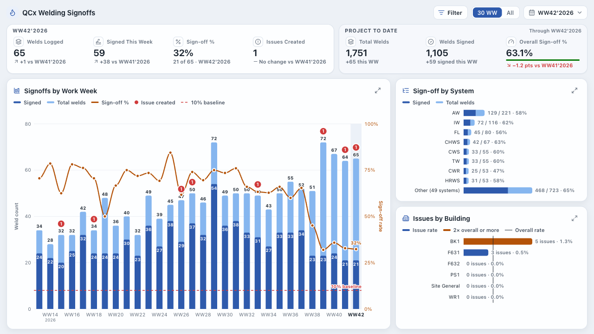
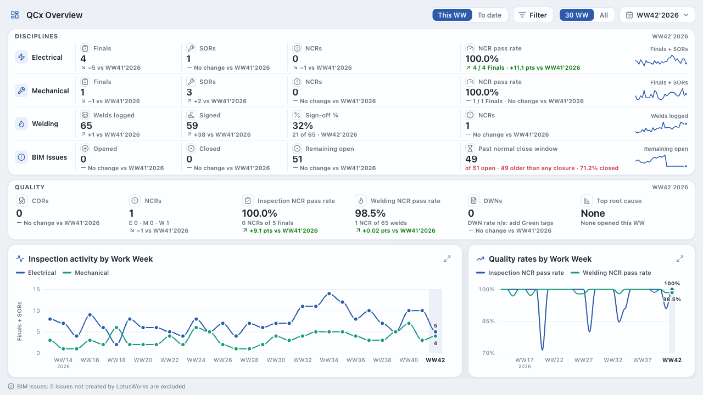

# PowerBI-Custom-Visuals

Power BI custom visuals I built with the Power BI visuals SDK (`pbiviz`), TypeScript and D3. Each visual is its own npm workspace package and builds to a `.pbiviz` file that you import into Power BI Desktop or the Power BI service.

There are 32 general-purpose charts and 8 domain visuals built for construction QA/QC reporting. The general charts share one library, `packages/core`, for formatting cards, selection, tooltips, accessibility and theming. The QA/QC visuals render React dashboards inside the visual and share `packages/qaqc-shared`.

## General charts

| Visual | Package | What it does |
|---|---|---|
| **KPIs and gauges** | | |
| KPI Card Pro | `kpi-card` | Value with count-up, trend arrow, sparkline, and optional target and change measures |
| Radial Gauge Pro | `radial-gauge` | Single gauge with color zones and a target tick |
| Gauge Cluster | `gauge-cluster` | Grid of small gauges, one per category |
| Bullet Chart Pro | `bullet-chart-pro` | Value bars against qualitative ranges and a target marker |
| Ring Stack | `ring-stack` | Concentric progress rings with percentage labels |
| Progress Bar Stack | `progress-bar-stack` | Stacked horizontal progress bars |
| Health Bar | `health-bar` | Vertical bars on a red-to-green scale for health percentages |
| Status Indicator | `status-indicator` | Colored status lights driven by thresholds |
| **Comparison and ranking** | | |
| Bar Chart Pro | `bar-chart-pro` | Grouped, stacked, combo (bar + line), horizontal and diverging modes |
| Bar Race | `bar-race` | Top-N bar chart race over a time field, with auto-play |
| Dumbbell Chart | `dumbbell-chart` | Start vs end value per category |
| Slope Chart | `slope-chart` | Before/after lines colored by direction |
| Bump Chart | `bump-chart` | Rank changes over time |
| Funnel Pro | `funnel-pro` | Funnel stages with conversion rate labels |
| Waffle Chart | `waffle-chart` | A percentage shown as a grid of cells |
| **Trends and time** | | |
| Morphing Area Chart | `morphing-area-chart` | Line chart with gradient fill and optional multi-series stacking |
| Stream Graph | `stream-graph` | Stacked areas around a center baseline |
| Heatmap Calendar | `heatmap-calendar` | Daily values on a calendar grid |
| Timeline Milestone | `timeline-milestone` | Horizontal timeline with milestone markers |
| Gantt Chart Pro | `gantt-chart-pro` | Task bars with progress fill, a today marker, and dependency and parent-task fields |
| **Part-to-whole and hierarchy** | | |
| Animated Donut Pro | `animated-donut-pro` | Donut with a center value and hover explode |
| Polar Nightingale Chart | `polar-chart` | Nightingale rose chart |
| Sunburst Chart | `sunburst-chart` | Hierarchy as rings, with drill-down zoom |
| Treemap Pro | `treemap-pro` | Hierarchy as nested rectangles, with drill-down zoom |
| Animated Waterfall Chart | `animated-waterfall` | Running total with connectors between steps |
| **Distribution and relationships** | | |
| Box Plot | `box-plot` | Min, Q1, median, Q3 and max per category, with optional outlier dots |
| Scatter Bubble Plot | `scatter-bubble` | X/Y scatter with an optional size field |
| Radar Chart | `radar-chart` | One polygon per series on a radial grid |
| Chord Diagram | `chord-diagram` | Flows between entities as ribbons |
| Network Graph | `network-graph` | Force-directed graph from source, target and weight fields, with dragging and optional node images |
| Sankey Diagram Pro | `sankey-diagram` | Flows across up to six levels (source, four middle steps, target) |
| **Filtering** | | |
| Filter Pane Pro | `filter-pane-pro` | Filter pane with a basic tab (pick values) and an advanced tab (contains, between, before/after, is blank and so on), applied through Power BI's JSON filter API |

Most of these animate on load. Animation can be turned off in the format pane.

## Domain visuals

These were built for construction QA/QC reporting. They read inspection logs and issue exports and show weekly quality numbers, drawing their own React charts and tables inside the visual.



| Visual | Package | What it does |
|---|---|---|
| QCx Overview | `qaqc-overview` | Electrical, mechanical, welding and BIM issue counts by work week, with quality rates |
| QCx Electrical Inspections | `qaqc-electrical` | Weekly Finals, SORs, NCR pass rate and a building breakdown |
| QCx Mechanical / Process Inspections | `qaqc-mechanical` | The same layout for the mechanical and process log |
| QCx Welding Signoffs | `qaqc-welding` | Weekly sign-off rate, issues created, and system and pipe-spec breakdowns |
| QCx Issues | `qaqc-issues` | Opened vs closed by work week, open-issue aging, a root cause Pareto and an issue detail table |
| QCx Performance | `qaqc-performance` | NCR pass rate by inspector and by welder, with a 30-week trend |
| QCx FFU Map | `qaqc-ffu-map` | Fan filter unit floor map drawn on a canvas, colored by energized status, with search, filters and cross-filtering |
| SSM Explorer | `ssm-explorer` | Milestone and equipment hierarchy with closest-parent and prerequisite links, and an Excel export of a milestone |

A custom visual only sees one table, so the Overview and Performance visuals read a combined table. `Business_Package/QCx_Combined.pq` is the Power Query (M) script that appends the four source tables into it, and the `QCx_*_SETUP.md` guides next to it cover field binding for each visual. `scripts/ffu-layout/extract_ffu_layout.py` turns a vector PDF of the FFU layout into the CSV the map reads (it needs PyMuPDF).



All the data these visuals are tested and previewed with is synthetic. `scripts/generate-qaqc-fixtures.mjs` writes it from a fixed seed: made-up buildings, contractors, issue titles, weld tags, inspectors and welders, with the same columns and the same untidy cells a real log has (spelling variants, blank and N/A values, free-text answers, dates in two formats). Both screenshots are that dev page (see below) rendering the generated data.

## Layout

```
packages/
  core/              shared library for the general charts
  qaqc-shared/       React components and data logic for the QA/QC visuals
  <visual>/          one folder per visual
    pbiviz.json        visual name, GUID, version
    capabilities.json  data roles and format pane objects
    src/               visual.ts, settings.ts, tests
    style/             visual.less
    stringResources/   display strings (en-US)
preview/             Vite page that renders the general charts with mock data
showcase.html        single-file version of that gallery
scripts/             packaging, review and maintenance scripts
Business_Package/    built .pbiviz files and setup guides
```

`packages/core` holds the format pane cards the visuals pick from (axis, legend, data labels, title, number format, sort, reference lines, trend line, target, conditional formatting, crosshair, annotations, color theme, accessibility), plus selection and cross-highlighting helpers, context menu handling, ARIA labels and keyboard navigation, high contrast colors, localization lookups and the animation helpers. Visuals import it with a relative path (`../../core/src`).

Each visual has its own `settings.ts` built on `powerbi-visuals-utils-formattingmodel`, so the format pane is defined in TypeScript and mirrored in `capabilities.json`.

## Build

Needs Node 20 or later. `npm install` at the root installs every workspace, then links the hoisted `powerbi-visuals-api` into each visual's own `node_modules`, which is where `pbiviz` looks for it (`scripts/link-visuals-api.mjs`).

```bash
npm install

npm run build:all                       # pbiviz package in every visual
npm run build -w @pbi/bar-chart-pro     # one visual
npm run typecheck
npm run package:business                # build everything, then copy the .pbiviz files into Business_Package/
npm run qa:business                     # typecheck, then review every visual's manifest and capabilities
```

A build writes `packages/<visual>/dist/<guid>.<version>.pbiviz`. The QA/QC builds also run `scripts/verify-pbiviz-css.mjs`, which opens the packaged file (it calls `unzip`) and checks that the stylesheet made it in.

`npm run review:business` (part of `qa:business`) goes through each visual's `pbiviz.json`, `capabilities.json`, `settings.ts` and `visual.ts` and flags things like a missing support URL, no data reduction, tooltips that don't use the host tooltip service, or measure roles without `supportsHighlight`. It writes the results to `Business_Package/review-report.json`.

The other scripts in `scripts/` roll a change across every package at once: `inject-capabilities.mjs` adds the shared format pane objects to each `capabilities.json`, `wire-formatting.mjs` and `wire-localizations.mjs` patch the visuals to use the shared formatting and string lookups, and `generate-coverage-tests.ts` writes a formatting coverage test for each visual.

## Run a visual in Power BI while developing

```bash
npx pbiviz install-cert                 # once, trusts the local dev server certificate
npm run start -w @pbi/kpi-card          # pbiviz dev server for one visual
```

Then turn on developer mode in the Power BI service settings and add the Developer Visual to a report page. It reloads from the dev server as you save.

The QA/QC visuals also have a Vite dev page that renders the dashboard outside Power BI with the synthetic data:

```bash
npm run dev -w @pbi/qaqc-issues
```

## Preview without Power BI

```bash
npm install --prefix preview            # first time only
npm run preview                         # http://localhost:5173
```

The preview renders the general charts with mock data using the same `core` helpers, with a light/dark toggle. `showcase.html` is a standalone version of that page that loads D3 from a CDN, so you can open it straight in a browser.

## Tests

```bash
npm test             # vitest run across every package
npm run test:watch
python3 -m unittest scripts/ffu-layout/test_extract_ffu_layout.py -v
```

Tests run in jsdom. `packages/core/src/__test-utils__` has a mock visual host, a `DataViewBuilder` for building data views, and a formatting test helper that the per-visual tests use. Every general chart has a `visual.test.ts` and a generated `formatting-coverage.test.ts` that checks each format pane setting reaches the rendered output. The QA/QC fixture tests pin their expected numbers to the synthetic data from `scripts/generate-qaqc-fixtures.mjs`. The timing tests in `qaqc-shared` run as a separate vitest project after everything else, so a busy machine doesn't skew them.

## Importing a visual into Power BI

1. Build it, or take the `.pbiviz` from `Business_Package/`.
2. In Power BI Desktop, open the Visualizations pane, select the `...` (Get more visuals) button and choose **Import a visual from a file**.
3. Pick the `.pbiviz` file. The visual's icon appears in the pane and works like a built-in visual.

The same option is in the Visualizations pane when editing a report in the Power BI service. Some tenants block visuals that aren't from AppSource; an admin can allow them under the tenant setting for visuals created with the Power BI SDK. Importing a newer version of the same visual replaces the old one, since the GUID stays the same.

## License

MIT
